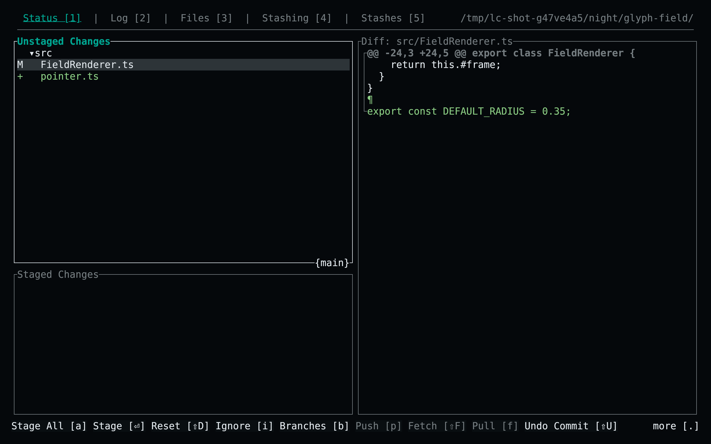
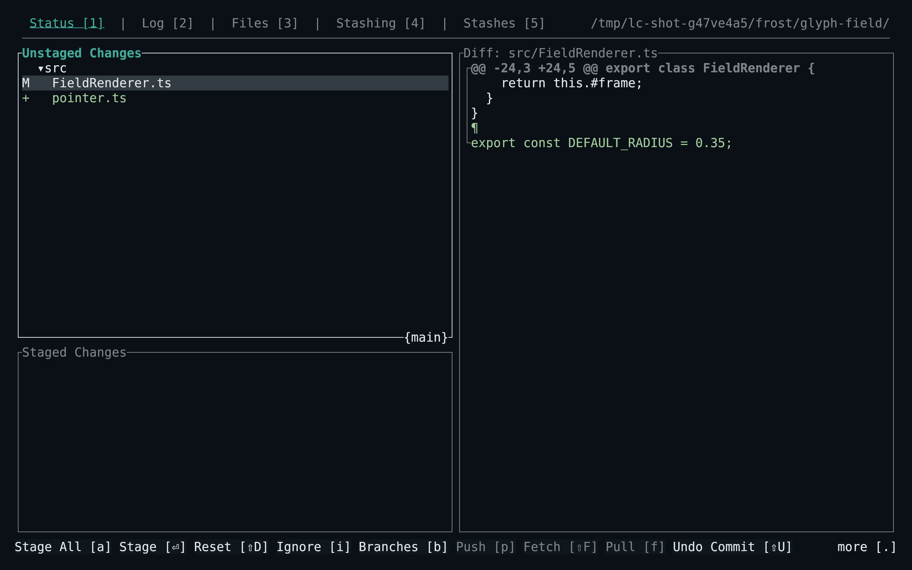
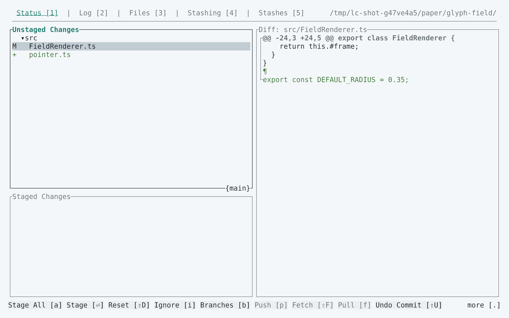
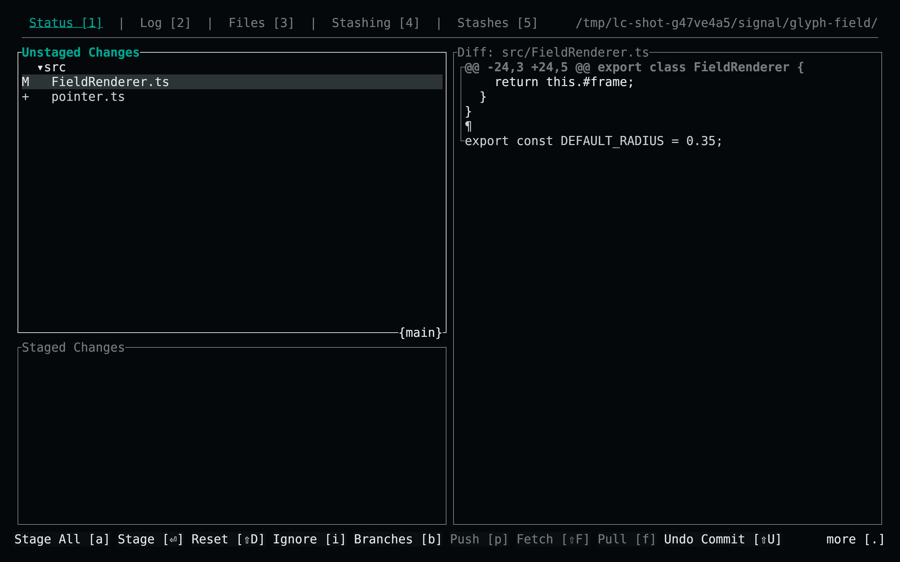

<!-- living-code-readme:1 -->
# 🌳 Living Code for GitUI

**Calm slate. Living color.** Living Code for GitUI: RON interface themes and matching native TextMate syntax palettes for commit, status and diff views.

[Installation](#installation) · [Flavors](#flavors) · [Configuration](#configuration) · [All ports](https://github.com/living-code-theme)

## Previews

<table data-lc-flavors>
<tr>
<td width="50%" valign="top">
<strong>Night</strong><br><sub>Dark · full palette</sub><br><br>
<a href="images/night.png"></a>
</td>
<td width="50%" valign="top">
<strong>Frost</strong><br><sub>Dark · softer chroma</sub><br><br>
<a href="images/frost.png"></a>
</td>
</tr>
<tr>
<td width="50%" valign="top">
<strong>Paper</strong><br><sub>Light · near-white slate</sub><br><br>
<a href="images/paper.png"></a>
</td>
<td width="50%" valign="top">
<strong>Signal</strong><br><sub>Dark · teal accent</sub><br><br>
<a href="images/signal.png"></a>
</td>
</tr>
</table>

Select any preview to view the image at full size.

## Installation

```sh
flavor=night # night, frost, paper, or signal
for extension in ron tmTheme; do
  curl -fsSL --create-dirs -o "${XDG_CONFIG_HOME:-$HOME/.config}/gitui/living-code-$flavor.$extension" "https://raw.githubusercontent.com/living-code-theme/gitui/main/themes/living-code-$flavor.$extension"
done
gitui -t "living-code-$flavor.ron"
```

Both files are required: the RON UI theme selects the matching TextMate syntax palette. On Windows, use `%APPDATA%\gitui`. If you use a custom GitUI config directory, download both files there.

## Flavors

Expand a flavor for its full-size preview and activation instructions.

<details data-lc-flavor="night">
<summary><strong>Night</strong> · Dark · full palette</summary>

<p><a href="images/night.png"></a></p>

```sh
gitui -t living-code-night.ron
```

</details>

<details data-lc-flavor="frost">
<summary><strong>Frost</strong> · Dark · softer chroma</summary>

<p><a href="images/frost.png"></a></p>

```sh
gitui -t living-code-frost.ron
```

</details>

<details data-lc-flavor="paper">
<summary><strong>Paper</strong> · Light · near-white slate</summary>

<p><a href="images/paper.png"></a></p>

```sh
gitui -t living-code-paper.ron
```

</details>

<details data-lc-flavor="signal">
<summary><strong>Signal</strong> · Dark · teal accent</summary>

<p><a href="images/signal.png"></a></p>

```sh
gitui -t living-code-signal.ron
```

</details>

## Configuration

To make a flavor the default, copy its `.ron` file to `theme.ron` in the GitUI configuration directory; keep the named `.tmTheme` there too. Every override uses the required `Some(...)` representation. The RON `syntax` setting is the TextMate filename stem. Syntax palettes distinguish values, variables, functions, types, properties, comments and diff scopes.

## Compatibility

Requires GitUI’s optional-override RON format introduced in 0.23, plus custom TextMate syntax loading. Verified against the pinned upstream `Theme` fields. GitUI does not expose a general body foreground/background override: configure a matching Living Code terminal palette for unpainted areas, especially with Paper. The port includes UI and syntax files rather than merely renaming an existing generic theme.

Previews are captured programmatically from the actual application in an isolated profile. See [`capture/app.py`](capture/app.py) for the app-owned recipe and [`images/capture.json`](images/capture.json) for runtime, palette and image provenance. No mock interface is drawn.

## Contributing

Found a problem? [Open an issue](https://github.com/living-code-theme/gitui/issues/new/choose) with the app version, the flavor and a screenshot. Want Living Code somewhere else? [Request a port](https://github.com/living-code-theme/core/issues/new?template=port-request.yml).

Pull requests are welcome. Keep this README, `port.json` and `images/` in sync, and use real screenshots of the app, never mockups.

🦎 **One chameleon, many habitats.** Part of [Living Code](https://github.com/living-code-theme).

## License

[MIT](LICENSE) © Elliot Luque
